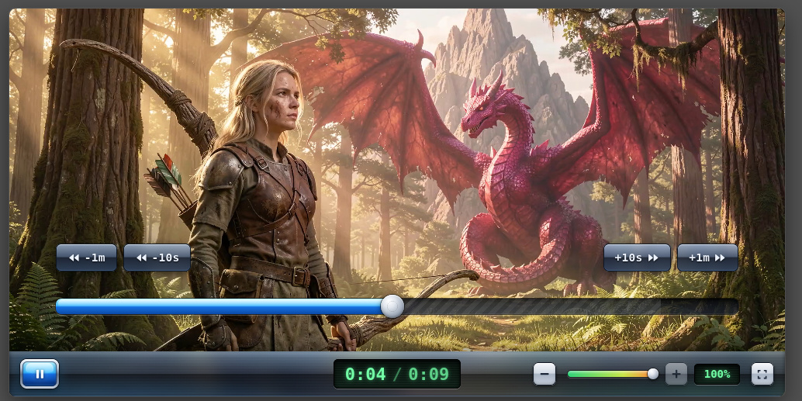

# Perfect Video Player

A prototype of how web video players *should* work. It replaces the native
`<video>` controls with a layout designed around one idea: **you should never
seek by accident**.



---

 

## The problem

On most players the seekbar is a thin line glued to the bottom of the video,
right above the buttons. It's hard to grab, hard to drag, and when you aim for
the play or volume button you often land on the seekbar instead and jump to
some random point of the video.

## The layout

```
┌─────────────────────────────────────────────────────────────┐
│                                                             │
│                          ( ▶ )                              │  ← play/pause feedback in the center
│                                                             │
├━━━━━━━━━━━━━━━━━━━●─────────────────────────────────────────┤  ← full-width seekbar directly above the panel
│ 2:36 / 10:00   [«1m][‹10s] [▶] [10s›][1m»]   [-] 64 [+]  [⛶]│  ← panel
└─────────────────────────────────────────────────────────────┘
```

## Strengths

- **Full-width seekbar directly above the bottom panel.** Big, easy to click
  and drag across the full width of the player, with a big LCD timestamp above
  the bar on hover.
- **Transport cluster in the center:** a big play/pause button with a
  machined chrome bezel and glossy aqua core, flanked by quick `1m` / `10s`
  rewind and forward buttons (`« 1m`, `‹ 10s`, `▶`, `10s ›`, `1m »`) when there
  is room (outer `1m` buttons hide first on narrower players, then `10s`).
- **Volume and a compact fullscreen button** on the bottom right:
  - `-` and `+` buttons (5% steps, hold to repeat, middle-click for 0 / 100) flanking a numeric LCD readout (click it to mute),
  - mouse wheel over the volume area changes it by 2%.
  - The volume is remembered between visits.
- **Two-row VFD display** on the bottom left showing time (`2:36 / 10:00`),
  resolution badge (`1080p` / `4K`), filename, file size (`46.3 MB`), and
  bitrate (`4.2 Mbps`). Clicking it opens a media info popup over the video
  with all available details at a glance (file, resolution, aspect ratio,
  duration, size, bitrate, format).
- **Click empty video space to play/pause, double-click for fullscreen.**
  Single-clicking the empty video area toggles playback (with clean centered
  feedback) and double-clicking it toggles fullscreen. Clicking or
  double-clicking the panel background does nothing so missed buttons never
  pause or fullscreen by accident.
- **Controls get out of the way.** They hide 0.5 seconds after the cursor
  leaves the player, after 2 seconds without moving over the empty video area,
  or immediately when entering fullscreen (ignoring movement for 0.5 seconds).
  They stay visible while the cursor rests on the bottom panel or seekbar, and
  never hide in the middle of a drag. The cursor hides too.
- **Looks good.** Glossy metal and glass inspired by Windows 98/XP, Winamp and
  FL Studio, kept clean and minimal.
- **Pleasant, but cheap, effects.** Sparks fly from the seekbar when you click
  or drag it, buttons ripple when pressed, and a big icon pops when toggling
  playback. Effects only use `transform`/`opacity`, sparks are capped, and the
  progress animation loop only runs while the video plays *and* the controls
  are visible. Everything decorative turns off with `prefers-reduced-motion`.
- **Scales with the player.** Sizes use container query units, so a 400px
  player gets compact controls and a fullscreen one gets big ones.
- **Keyboard support** when the player is focused (see below).
- **No dependencies or build step.** Plain JS + CSS.

## Usage

Copy these files into your site:

```
css/main/perfect_player.css
js/main/perfect_player.js
```

Include them:

```html
<link rel="stylesheet" href="css/main/perfect_player.css">
<script src="js/main/perfect_player.js"></script>
```

### Automatic

Add `data-perfect-player` to any `<video>`. It gets upgraded when the DOM is
ready:

```html
<video data-perfect-player src="movie.mp4" poster="poster.jpg"></video>
```

Any `controls` attribute is removed. Host CSS, inline styles, classes, margins,
hide/show toggles, and event listeners on the `<video>` continue to work as-is
— the controls overlay automatically tracks the `<video>`'s rendered box.

Options can also be set in HTML using `data-pvp-*` attributes:

```html
<video data-perfect-player data-pvp-volume-step="5" data-pvp-keyboard="false" src="movie.mp4"></video>
```

### Manual

```js
let player = PerfectPlayer.upgrade(document.querySelector(`#my_video`), {
  volume_step: 5,
  hide_delay_idle: 2000,
})

// Calling upgrade() again returns the existing instance; get() looks it up
let same = PerfectPlayer.get(`#my_video`)

player.play()
player.pause()
player.toggle_play()
player.seek_to(90)
player.set_volume(50)
player.toggle_mute()
player.toggle_fullscreen()

// The original element is still there, use it for anything else
player.video.addEventListener(`ended`, () => {})

// Put the plain <video> back
player.destroy()
```

Upgrade a custom selection:

```js
PerfectPlayer.upgrade_all(`.article video`)
```

### Options

| Option                  | Default                 | Description                                             |
|-------------------------|-------------------------|---------------------------------------------------------|
| `volume_step`           | `5`                     | Percent per button press or arrow key                   |
| `volume_step_wheel`     | `2`                     | Percent per mouse wheel tick                            |
| `seek_step`             | `10`                    | Seconds for `-10s`/`+10s` and left/right arrow keys     |
| `seek_step_long`        | `60`                    | Seconds for the `-1m`/`+1m` buttons                     |
| `hide_delay_leave`      | `500`                   | ms to hide controls after the cursor leaves             |
| `hide_delay_idle`       | `2000`                  | ms to hide controls after idle on empty video area      |
| `fullscreen_hide_block` | `500`                   | ms to ignore pointer movement after entering fullscreen |
| `click_to_play`         | `true`                  | Single click on empty video space toggles play/pause    |
| `remember_volume`       | `true`                  | Save the volume in `localStorage`                       |
| `storage_key`           | `perfect_player_volume` | `localStorage` key for the volume                       |
| `fullscreen_button`     | `true`                  | Show the compact fullscreen button on the bottom right  |
| `particles`             | `true`                  | Sparks on the seekbar                                   |
| `keyboard`              | `true`                  | Keyboard shortcuts while focused                        |

Global defaults can be changed through `PerfectPlayer.defaults`.

### Keyboard

| Key                  | Action              |
|----------------------|---------------------|
| `Space` / `K`        | Play / Pause        |
| `←` / `→`            | Seek 10 seconds     |
| `J` / `L`            | Seek 10 seconds     |
| `↑` / `↓`            | Volume ±5%          |
| `M`                  | Mute                |
| `F`                  | Fullscreen          |
| `0`–`9`              | Jump to 0%–90%      |
| `Home` / `End`       | Start / End         |

### Theming

Every color and size is a CSS custom property on `.pvp`:

```css
.pvp {
  --pvp_accent_top: #ffd9b4;
  --pvp_accent_mid: #ff9a3c;
  --pvp_accent_low: #e06216;
  --pvp_accent_end: #a8420b;
  --pvp_glow: rgba(255, 150, 70, 0.6);
  --pvp_lcd_text: #ffcf5a;
}
```

## Files

| File                          | Purpose                                      |
|-------------------------------|----------------------------------------------|
| `js/main/perfect_player.js`   | The player (`PerfectPlayer` class)           |
| `css/main/perfect_player.css` | Player styles and theme variables            |
| `index.html`                  | Demo page                                    |
| `js/main/demo.js`             | Demo page logic (local file / URL loader)    |
| `css/main/demo.css`           | Demo page styles                             |

## Demo

Open `index.html` in a browser, or serve the folder:

```sh
python -m http.server
```

> Note: seeking needs a server that supports HTTP Range requests (nginx,
> Apache, Caddy, most CDNs). Python's `http.server` doesn't support them, so
> seeking a video served by it jumps back to the start in Chrome. This affects
> any player, not just this one.

## Browser support

Modern evergreen browsers (Chrome, Edge, Firefox, Safari 16+). It relies on
pointer events, container queries and `backdrop-filter`.

## License

[MIT](LICENSE)
